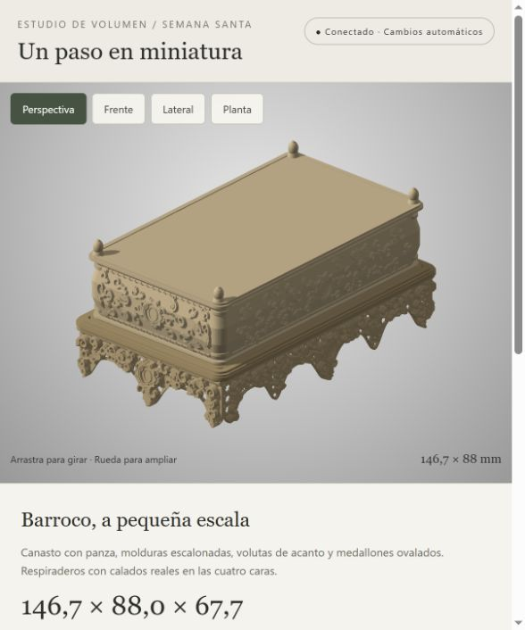

# Paso de Semana Santa en 3D

Maqueta paramétrica de un paso barroco, desarrollada a partir de la fotografía de un frente. Incluye canastilla tallada, tablero superior, molduras y cuatro respiraderos con una celosía de estrellas de ocho puntas y rombos detrás de la ornamentación.

**Medidas:** 146,7 × 88 × 67,7 mm. Diseño para PLA y Prusa MK3S+, con boquilla de 0,4 mm como referencia.



## Visor online

[Abrir el modelo 3D en el navegador](https://wincrash91.github.io/paso-semana-santa-3d/).

No requiere instalación. Permite girar, ampliar y mostrar u ocultar partes del paso. La fotografía de referencia solo se carga en el visor local.

## Visor local

Se necesita Node.js. Desde la carpeta del proyecto:

```sh
node servir_visor.cjs
```

Abrir [el visor local](http://127.0.0.1:8765/modelo_paso/visor.html). En Windows también se puede ejecutar `Abrir visor.cmd`.

Arrastrar para girar, usar la rueda para ampliar y los botones para elegir vistas. La luz permanece fija. El visor comprueba los cambios del GLB cada segundo y conserva la cámara al actualizarlo. No utiliza servicios externos.

## Editar y regenerar el modelo

Se ha desarrollado con Python 3.12. Crear un entorno e instalar las dependencias:

```sh
python -m venv .venv
```

En Windows:

```powershell
.venv\Scripts\python -m pip install -r requirements.txt
.venv\Scripts\python generar_paso.py
```

En macOS/Linux:

```sh
.venv/bin/python -m pip install -r requirements.txt
.venv/bin/python generar_paso.py
```

El archivo `generar_paso.py` contiene las medidas, la geometría y la ornamentación. Cada ejecución sustituye los mismos modelos; el visor recibe el nuevo GLB cuando se ha completado la generación y la comprobación de mallas.

## Modelos y referencia

- `modelo_paso/paso_completo.glb`: conjunto para visualizar; unidades glTF en metros.
- `modelo_paso/paso_completo_revision.stl`: conjunto de revisión en milímetros. Si se distribuye comprimido, extraer el ZIP del mismo nombre.
- `modelo_paso/validacion.json`: dimensiones, continuidad y comprobaciones geométricas.
- La fotografía original de referencia se conserva solo en el espacio de trabajo local y no se distribuye en este repositorio. Laterales, trasera y cubierta son una interpretación.

La talla utiliza rizos compactos y calados orgánicos. La celosía tiene una repetición de 5,2 mm, espesor de 1,2 mm y nervios de aproximadamente 0,9–1 mm.

El diseño está pendiente de despiece, uniones, orientación de impresión y laminado. El STL completo sirve para revisar la forma; todavía no es un juego de piezas listo para imprimir. No se incluye G-code.
